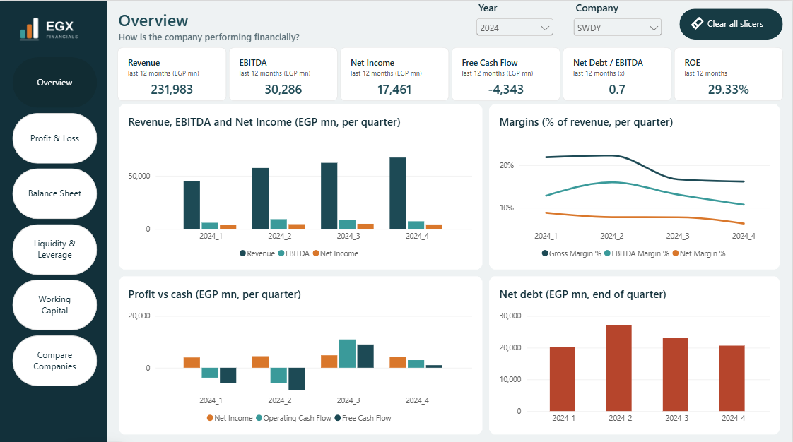
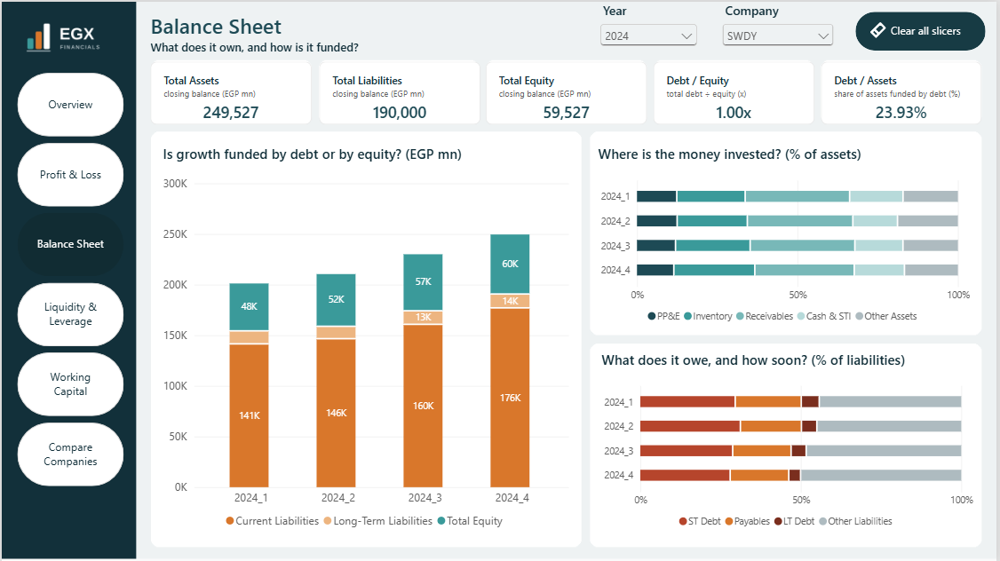
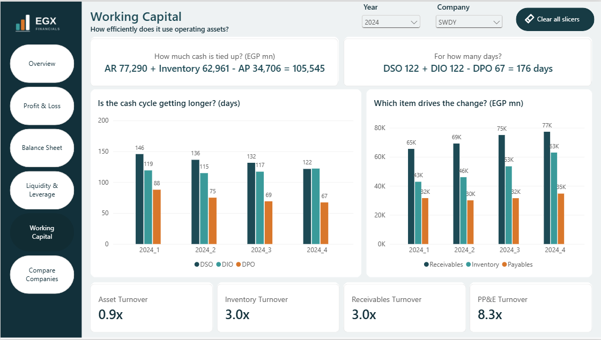
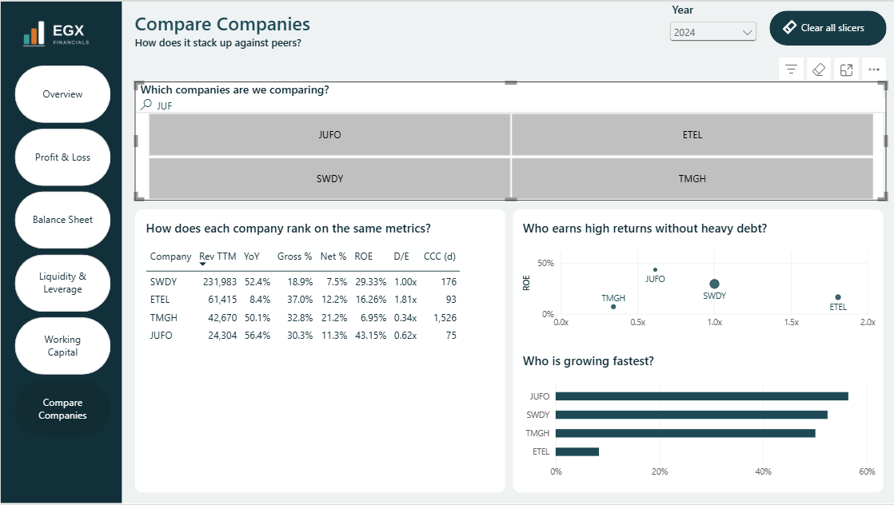

# EGX Financial Analysis \| End-to-End Data Analytics Project

An end-to-end financial data analytics project focused on analyzing the
financial performance of companies listed on the Egyptian Exchange (EGX)
using Python, SQL Server, and Power BI.

The project transforms raw financial statement data into structured
datasets, analytical metrics, and an interactive dashboard designed to
support financial performance evaluation and company comparison.

## Project Overview

Financial statements contain valuable information about a company's
profitability, liquidity, leverage, operational efficiency, and cash
flow. Comparing companies and understanding their performance over time
requires a structured data pipeline and meaningful financial metrics.

This project demonstrates an end-to-end analytics workflow, from web
scraping and data transformation to SQL-based data modeling and
interactive financial reporting.

### Project Highlights

-   **212 companies** with successfully retrieved financial data.
-   **264,376 rows** loaded into SQL Server.
-   Automated financial data collection using Python.
-   Financial data transformation and modeling using SQL Server.
-   Financial KPIs and analytical measures using DAX.
-   An interactive Power BI dashboard with six analytical pages.

*Coverage reflects the project's data collection results and may vary
depending on source availability.*

## Business Objectives

-   Analyze financial performance across EGX-listed companies.
-   Evaluate revenue, profitability, assets, liabilities, and cash flow.
-   Assess liquidity and financial leverage.
-   Understand working capital efficiency and the cash conversion cycle.
-   Compare companies using financial ratios and performance indicators.
-   Present financial information through interactive visualizations.

## Technology Stack

  Technology            Purpose
  --------------------- -------------------------------------------------
  Python                Web scraping and data preparation
  Pandas                Data cleaning and transformation
  Requests              Retrieving financial statement pages
  SQLAlchemy & pyodbc   Connecting Python to SQL Server
  SQL Server            Data storage, transformation, and modeling
  SQL Views             Structuring financial data and deriving metrics
  DAX                   Financial calculations and analytical measures
  Power BI              Interactive dashboards and financial reporting

## Data Pipeline

The project follows a structured ETL workflow.

1.  **Data Extraction:** Retrieve company financial statement data from
    StockAnalysis.com.
2.  **Data Transformation:** Parse tables, clean extracted data,
    standardize reporting periods, and reshape financial statement data
    into a structured format.
3.  **Data Loading:** Load the transformed records into SQL Server.
4.  **Data Modeling:** Build SQL views to organize financial accounts,
    companies, statements, reporting periods, and derived financial
    metrics.
5.  **Financial Analysis:** Calculate profitability, liquidity,
    leverage, cash flow, and working capital indicators.
6.  **Visualization:** Build an interactive Power BI dashboard for
    financial analysis and company comparison.

### Data Model

The SQL model includes:

-   `Staging_Financials`: Structured financial statement records.
-   `DimAccount`: Financial account information.
-   `DimCompany`: Company dimension.
-   `DimStatement`: Financial statement dimension.
-   `DimCalendar`: Reporting-period dimension.
-   `Fact_Financials`: Structured financial statement data.
-   `Fact_Metrics`: Derived financial metrics used for analysis.

The model uses SQL views to transform statement-level records into a
structure suitable for financial reporting and analysis.

## Financial KPIs & Metrics

The dashboard covers several important areas of financial analysis.

### 1. Profitability Analysis

  -----------------------------------------------------------------------
  Metric                              What it measures
  ----------------------------------- -----------------------------------
  Revenue                             Income generated from business
                                      activities

  Gross Profit Margin                 Gross profit relative to revenue

  Operating Margin                    Operating income relative to
                                      revenue

  Net Profit Margin                   Net income relative to revenue

  EBITDA                              Earnings before interest, taxes,
                                      depreciation, and amortization

  Return on Equity (ROE)              Net income relative to
                                      shareholders' equity
  -----------------------------------------------------------------------

### 2. Growth Analysis

  -----------------------------------------------------------------------
  Metric                              What it measures
  ----------------------------------- -----------------------------------
  Revenue Growth YoY                  Year-over-year revenue growth

  Net Income Growth                   Change in net income compared with
                                      the prior-year period

  Revenue TTM                         Revenue over the trailing twelve
                                      months

  EBITDA TTM                          EBITDA over the trailing twelve
                                      months

  Net Income TTM                      Net income over the trailing twelve
                                      months
  -----------------------------------------------------------------------

### 3. Liquidity & Leverage

  -----------------------------------------------------------------------
  Metric                              What it measures
  ----------------------------------- -----------------------------------
  Current Ratio                       Ability to cover current
                                      liabilities using current assets

  Debt-to-Equity                      Total debt relative to
                                      shareholders' equity

  Net Debt                            Total debt less cash and short-term
                                      investments

  Net Debt / EBITDA                   Net debt relative to EBITDA

  Interest Coverage                   Ability to cover interest expense
                                      using operating earnings
  -----------------------------------------------------------------------

### 4. Cash Flow Analysis

  -----------------------------------------------------------------------
  Metric                              What it measures
  ----------------------------------- -----------------------------------
  Operating Cash Flow                 Cash generated by operating
                                      activities

  Capital Expenditures (CapEx)        Cash spent on acquiring or
                                      maintaining long-term assets

  Free Cash Flow (FCF)                Operating cash flow less capital
                                      expenditures
  -----------------------------------------------------------------------

### 5. Working Capital Analysis

  -----------------------------------------------------------------------
  Metric                              What it measures
  ----------------------------------- -----------------------------------
  Days Sales Outstanding (DSO)        Average time needed to collect
                                      receivables

  Days Inventory Outstanding (DIO)    Average time inventory remains
                                      outstanding

  Days Payables Outstanding (DPO)     Average time taken to pay suppliers

  Cash Conversion Cycle (CCC)         Time between cash outflows for
                                      operations and cash inflows from
                                      sales
  -----------------------------------------------------------------------

**Financial interpretation matters:** ratios should be evaluated in
context, considering the company's industry, business model, reporting
periods, and data availability. A metric that is useful for a
manufacturing company may not be meaningful for a bank or insurer.

## Power BI Dashboard

The report contains six analytical pages.

### 1. Overview

Provides a high-level summary of financial performance, including
revenue, EBITDA, net income, leverage, and profitability trends.

### 2. Profit & Loss

Analyzes revenue, expenses, profitability, and changes in financial
performance over time.

### 3. Balance Sheet

Examines assets, liabilities, equity, and the composition of the
company's financial position.

### 4. Liquidity & Leverage

Evaluates short-term liquidity, debt levels, interest coverage, and
financial risk indicators.

### 5. Working Capital

Analyzes receivables, inventory, payables, and the cash conversion
cycle.

### 6. Compare Companies

Supports company-level comparison using financial ratios, revenue
growth, profitability, and leverage indicators.

## Dashboard Preview

The Power BI dashboard consists of six interactive pages designed to
analyze financial performance, evaluate key financial indicators, and
compare companies listed on the Egyptian Exchange (EGX).

### 1. Overview

Provides a high-level summary of financial performance, including key
financial indicators and trends.

### 2. Profit & Loss

Analyzes revenue, expenses, profitability, and financial performance
over time.

### 3. Balance Sheet

Examines assets, liabilities, equity, and the company's financial
position.

### 4. Liquidity & Leverage

Evaluates liquidity, debt levels, and the company's ability to meet its
financial obligations.

### 5. Working Capital

Analyzes receivables, inventory, payables, and the cash conversion
cycle.

### 6. Compare Companies

Enables comparisons across companies using profitability, leverage, and
growth indicators.

## Example Financial Analysis

A validation example from the project uses Elsewedy Electric (SWDY) for
2024.

  Metric                     Reported value
  ------------------------ ----------------
  Revenue TTM                       231,983
  EBITDA TTM                         30,286
  Net Income TTM                     17,461
  Return on Equity (ROE)             29.33%
  Net Debt / EBITDA                   0.68x
  Interest Coverage                    3.6x
  Total Assets                      249,527
  Total Liabilities                 190,000
  Total Equity                       59,527
  Debt-to-Equity                      1.00x

*Amounts are presented in the source data's reporting units. These are
project validation figures and should be checked against the
corresponding source statements before being used for investment
decisions.*

One important validation check is the balance sheet equation:

**Total Assets = Total Liabilities + Total Equity**

For SWDY in 2024:

`249,527 = 190,000 + 59,527`

## Data Quality & Analytical Considerations

The project accounts for several practical challenges in financial data
analysis:

-   Missing financial values are preserved as missing rather than
    automatically converted to zero.
-   Negative financial values retain their original signs.
-   Different financial statement periods are mapped to reporting dates.
-   Trailing twelve-month calculations use the company's own latest
    available reporting quarter.
-   Balance sheet metrics use the latest available closing balance
    within the selected period.
-   TTM-based ratios require sufficient quarterly history.
-   Some metrics are not applicable to banks and insurers because their
    financial statement structures differ from those of industrial
    companies.
-   Some companies have missing reporting periods or non-calendar fiscal
    years.

These considerations help reduce misleading comparisons and improve the
reliability of the analytical output.

## Project Structure

The repository is organized into folders for the project's main
components:

-   `src/` --- Python scripts and data extraction workflows.
-   `sql/` --- SQL scripts and data modeling.
-   `power bi/` --- Power BI report files.
-   `data/` --- Project data and supporting files.
-   `images/` --- Dashboard screenshots.
-   `Backgrounds_1280x720/` --- Dashboard background assets.
-   `EGX_Financials_theme.json` --- Power BI theme configuration.
-   `tickers.txt` --- Company ticker list.
-   `README.md` --- Project documentation.

## Skills Demonstrated

-   Web scraping and data extraction
-   Data cleaning and transformation
-   ETL pipeline development
-   SQL querying and data modeling
-   Financial statement analysis
-   KPI development and financial ratio analysis
-   DAX measures and time-based calculations
-   Power BI dashboard development
-   Data validation and analytical storytelling

## Future Improvements

-   Add an annual versus quarterly reporting toggle.
-   Expand automated data quality checks.
-   Improve coverage for companies with unavailable source pages.
-   Add further industry-specific financial metrics.
-   Enhance dashboard documentation with additional business insights.

## Disclaimer

This project is intended for educational and analytical purposes. It
does not constitute investment advice, a stock recommendation, or a
guarantee of future financial performance. Financial data coverage and
accuracy depend on the availability and quality of the source data.

## Author

**Mohamed Badar**

Data Analytics \| Python \| SQL Server \| Power BI

GitHub: [BadAr-78](https://github.com/BadAr-78)
